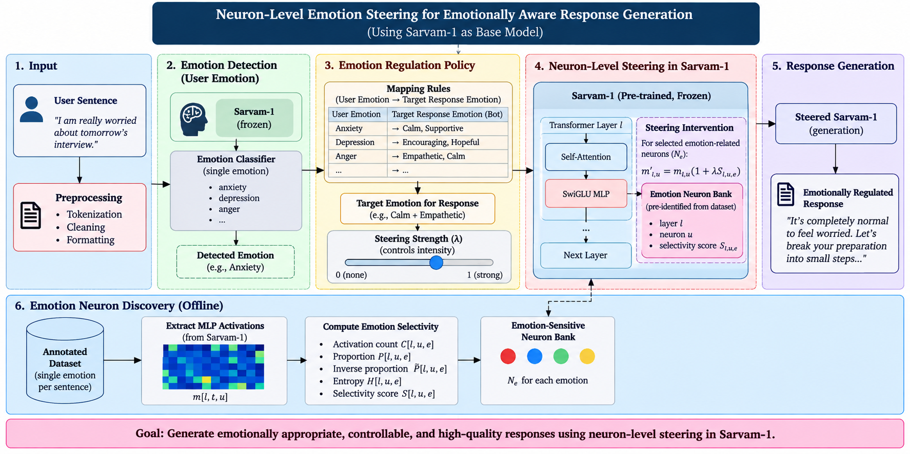

# MindMate — local Llama and Sarvam chat

A responsive React + TypeScript frontend with Tailwind CSS, Lucide icons, and Recharts. Chat supports local Llama 3.1 8B and Sarvam 30B models loaded from Hugging Face. For Llama, each user message is classified by a frozen emotion probe and replies can be steered through emotion-writing MLP neurons (see API).



*Conceptual neuron-level emotion steering pipeline. The diagram shows the
Sarvam-1 research path; MindMate currently exposes both Llama and Sarvam model
presets, as described below.*

## Dataset

The project includes [GoEmotions hard labels](data/goemotions_hardlabels.csv): 57,732 text examples with one `text` column and 28 binary label columns. The labels cover 27 emotions plus `neutral`.

See [data/README.md](data/README.md) for the column format and intended use. The local Llama and Sarvam chat service does not currently train on or infer emotion labels from this dataset.

## Run

Install Python dependencies in your model environment. A production frontend is
already included in `frontend/dist`, so Node.js is only required when you change
the frontend source:

```sh
python3 -m pip install -r backend/requirements.txt
python3 -m backend.server --port 8080
```

Open **http://127.0.0.1:8080**. When using SSH, forward port 8080 in your IDE. The Python server serves both the built UI and API; no separate frontend server is needed.

After changing files under `frontend/src`, install Node.js 20.19+ (or 22.12+)
and rebuild from the project root. Keep the commands separate so a failed
frontend build does not leave the terminal in `frontend/` before starting the
backend:

```sh
cd frontend
npm install
npm run build
cd ..
python3 -m backend.server --port 8080
```

The model uses cached weights when available. Downloading uncached gated weights requires Hugging Face access. You can specify `--model-id /path/to/checkpoint`. Sarvam uses 4-bit NF4 quantization by default; bitsandbytes is included in the requirements. Llama can opt in with `--load-in-4bit`. Use `--no-load-in-4bit` to disable quantization. Without CUDA, inference uses CPU and may be very slow.

### Choose Llama or Sarvam

Llama 3.1 8B Instruct is the default. Start it with:

```sh
python3 -m backend.server --port 8080
```

To save an architecture report without downloading the 8B parameter weights:

```sh
python3 inspect_llama_architecture.py
```

To additionally load the checkpoint and save every transformer layer's
attention/MLP projection shapes plus the exact parameter count:

```sh
python3 inspect_llama_architecture.py --load-weights
```

Both commands write to `results/llama31_8b_architecture/architecture.json`.

### Llama neuron-analysis pipeline

The Sarvam-1 neuron-analysis sequence has been switched to
`meta-llama/Llama-3.1-8B-Instruct`. Its Llama-specific shape is validated as
32 transformer layers with 14,336 MLP dimensions per layer, and all generated
data is written below `results/llama31_8b_*` so existing Sarvam results remain
available. Authenticate with Hugging Face and run the complete sequence with:

```sh
hf auth login
python3 -m pip install -r backend/requirements.txt
bash run_llama_analysis.sh
```

For a short initial hardware test, inspect only the model configuration:

```sh
python3 inspect_llama_architecture.py
```

The Sarvam preset is in `backend/sarvam_config.py` and loads
[`sarvamai/sarvam-30b`](https://huggingface.co/sarvamai/sarvam-30b).
Its custom architecture requires `trust_remote_code=True`, enabled by this preset.
Install the updated requirements first (Transformers 4.57.2 or newer, below 5).
Sarvam loads through `backend/sarvam.py`, independently of the Llama entry point.
Shared loading mechanics are in `backend/runtime.py`. Sarvam receives conversation
history without a MindMate/persona system prompt. Sarvam uses its native thinking
template; the backend removes reasoning tokens and returns only the final answer.
Do not append an empty thinking block or ban its thinking token: GPU testing
reproduced runaway self-descriptions with that forced prefix. Llama retains its
existing MindMate prompt.
The connection indicator displays the loaded model ID.

To use Llama later, stop the server and run:

```sh
python3 -m backend.server --model llama --port 8080
```

One model is loaded per server. To compare responses, send the same messages to
each model after restarting and reload the browser for a fresh conversation.
With enough memory, run the two presets on separate ports (8080 and 8081) and
open each URL separately. API responses include model ID, latency, and token count.
For a local Sarvam checkpoint, use `--model sarvam --model-id /path/to/checkpoint`.

Sarvam loads weights in 4-bit to reduce memory usage. Runtime memory also includes
unquantized layers, quantization metadata, and the context cache, so actual usage
must be checked on your hardware. Quantization happens during loading; the original
Hugging Face checkpoint still needs to be downloaded and cached.
Uncached weights download
from Hugging Face at startup; authentication uses `HF_TOKEN` or `hf auth login`.

Emotion-neuron extraction for the supplied single-label Hinglish dataset:

```sh
python3 emotion_neuron_statistics.py \
  --model-id sarvamai/sarvam-1 \
  --csv-path data/mlt_hinghlish_dataset_clean.csv \
  --text-column hinglish_genz_text --label-column label \
  --output-dir results/sarvam1_emotions_full --batch-size 2
```

The extraction script loads Sarvam-1 in unquantized BF16 on CUDA, disables the KV
cache, and uses batch size 32 with max sequence length 256 by default. The source
CSV contains 30,000 rows and 4,492 duplicate text-label rows. The
cleaned CSV contains 25,508 rows with no missing values or duplicate pairs.
The duplicate removal is intentionally not followed by class balancing. Omitting
`--max-samples` processes all cleaned rows; add `--max-samples 500` only for a
smoke test.

For a UI/connectivity preview without loading model weights:

```sh
python3 -m backend.server --no-model --port 8080
```

The UI works in this mode, but sending a message returns an explicit model-unavailable error. There is no mock response or external provider fallback.

## Frontend development

Run the backend on port 8080 and, in another terminal:

```sh
cd frontend
npm run dev
```

Open the Vite URL (normally http://127.0.0.1:5173). Vite proxies `/api` to the local backend. Production uses same-origin requests.

## Behavior

- Chat is selected by default; Mood Tracker replaces the main view. Chat and unsent drafts survive navigation.
- Chat opens empty and displays only your messages and the selected model’s responses.
- Enter sends, Shift+Enter inserts a newline. Responses show a waiting indicator; failed requests can be retried without duplicating the user turn.
- Messages live in browser memory and reset on reload. Only the visual theme is saved in localStorage.
- Attachment uploads are not supported; the paperclip is decorative and labelled accordingly.
- Mood Tracker records the saved 10-class probe's result for each user turn in the current browser conversation. It resets on reload and is a research visualization, not a clinical assessment.
- `src/api/chat.ts` isolates the real API integration; `src/types/` defines future emotion/controller contracts.

## API

`GET /api/status` reports model readiness. `POST /api/chat/stream` accepts the same alternating user/assistant `messages` and sends visible response text as it is generated. The frontend uses this streaming endpoint. `POST /api/chat` remains available for non-streaming clients. For the configured Llama checkpoint, every `/api/chat` and `/api/chat/stream` turn is planned by the **Emotion Reasoner Agent** (`chatbot_feature/emotion_reasoner/`). It fuses the frozen 10-class probe with a knowledge graph (cue phrases -> cause -> emotion -> need -> strategy -> response emotion), picks a therapist-inspired response strategy, adds that strategy's guidance to the system prompt, and sets the neuron-steering emotion and strength itself; there is no manual control in the UI. Messages suggesting self-harm get a safety strategy with steering switched off. The steering shifts a panel of emotion-writing MLP neurons (layers 8-18, top 1% per layer, 1,573 neurons) on every decoding step; panels are built by `python3 -m generation_analysis.build_steering_panels`. Responses carry a turn id (`X-Turn-Id` header, or `turn_id` and `emotion_plan` in JSON). `GET /api/emotion/trace/<turn_id>` returns the plan, the hook-measured activations of the steered neurons in the steered reply and in an unsteered reply to the same prompt, and classifier-estimated emotion scores of both replies; the Mood Tracker displays this. For experiments, a request may still pass `steering_alpha` (-2 to 2) and `steering_emotion` to override the agent. With `MCP_ENABLED`, the same agent runs as the first node of the LangGraph workflow and conversational replies are steered by its plan. The agent is a supportive aid, not a therapist. Sarvam uses no system prompt for these endpoints. `POST /api/workspace/chat` additionally accepts an explicit `system_prompt` for compatibility.

For Llama, non-streaming `POST /api/chat` responses include `emotion_detection`: the detected label, confidence and all ten probe probabilities, plus the steered emotion and its panel size when alpha is nonzero. This makes it suitable for alpha sweeps and baseline-versus-steered comparisons from the terminal.

The frontend sends up to 41 messages; the backend trims oldest complete turns to a 16384-token context budget. Generation is deterministic. Sarvam recognizes both checkpoint end markers and has a 4096-token generation budget including hidden reasoning; Llama has a 1024-token budget. Incomplete reasoning is rejected rather than displayed. Requests wait up to ten minutes before showing a timeout. The server checks port availability before loading weights.

## Checks

```sh
python3 -m unittest discover -s tests -v
cd frontend
npm run build
```
